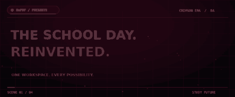

<div align="center">

  <a href="https://8apdf.me">
    
  </a>

  # 8aPDF

  ### STUDY INTELLIGENCE FOR THE FUTURE.

  <p><strong>Not another PDF folder. Your entire school day, reimagined.</strong></p>

  <p>
    <a href="https://8apdf.me"></a>
    <a href="https://github.com/nullreaperexe-cloud/The-8aPDF"></a>
  </p>

  <a href="https://8apdf.me" title="Open the live 8aPDF workspace">
    
  </a>

  <sub>🎬 <strong>THE CRIMSON ERA</strong> — a looping, soundless four-scene README trailer. No player or sign-in required.</sub>

  <p>
    
    
    
    
    
  </p>

  **[Launch 8aPDF](https://8apdf.me/)** · **[Study Materials](https://8apdf.me/pdfs)** · **[Friends Chat](https://8apdf.me/chat)** · **[Live Database](https://8apdf.me/live-database)**

</div>

---

## 🎬 ABOUT 8aPDF — THE STORY BEHIND THE SCREEN

**Imagine this.** The bell rings. Teacher messages are scattered, tomorrow's work is easy to forget, your PDFs live in different places, and finding *that one chapter* somehow takes longer than studying it.

**Now imagine opening one page.**

A deep-black, crimson-lit study space comes alive. One search finds what matters. Each card lifts into focus. School updates turn into something you can actually follow. Your next timetable day is right there. Your notes, music, study tools, and classmates feel connected.

**That's 8aPDF.** Built as a real study workspace for students, not just a directory of downloadable files.

### THE FOUR SCENES

| In the frame | What's really inside |
| :-- | :-- |
| **01 / THE SCHOOL DAY, REINVENTED** | School resources, teacher announcements, timetable, reminders and everyday study essentials in one place. |
| **02 / ONE SEARCH. EVERY ANSWER.** | Search subject-wise PDFs and announcements; preview, download, bookmark, share or summarize supported documents. |
| **03 / LESS CHAOS. MORE CLARITY.** | Upcoming tests, rotating school days, personal tasks, quick notes and optional focus widgets — without crowding the homepage. |
| **04 / YOUR STUDY UNIVERSE.** | Friends Chat, a music library, name-based welcomes, responsive navigation and a black/crimson or light/crimson experience you can make your own. |

> **THE IDEA:** Less hunting. More learning. Less noise. More momentum.
>
> **THE MISSION:** Turn a normal school day into a beautifully organized one.

<div align="center">
  <strong>🔴 THIS ISN'T THE END OF THE TRAILER. IT'S THE START OF YOUR NEXT CHAPTER.</strong>
  <br />
  <sub>The animated sequence above is an illustrated product teaser, not a recording of the actual interface.</sub>
  <br /><br />
  <a href="https://8apdf.me"><strong>▶ ENTER 8aPDF — 8apdf.me</strong></a>
</div>

---

## 🧭 THE EXPERIENCE — MORE THAN A PDF LIBRARY

| Your space | What it does |
| :-- | :-- |
| 📚 **Crimson PDF Library** | Explore study materials by subject; search, preview, download, bookmark and share PDFs. |
| 📢 **Teacher Announcements** | Keep school notices, assignments and available attachments within reach. |
| 🗓️ **Timetable & Calendar** | Follow the rotating school-day timetable and check school dates and holidays. |
| 📝 **Quick Notes, Tasks & Tests** | Keep personal to-dos and look up test/submission references from school updates. |
| 🤖 **AI Study Features** | Ask school-content questions and generate summaries where source PDFs are readable and AI services are configured. |
| 💬 **Friends Chat** | Talk in rooms and private conversations with supported replies, reactions and file sharing. |
| 🎵 **Music Library** | Play tracks in the study workspace and choose whether you want background music. |
| 🎯 **Focus Studio** | Study with focus and break timers, plus optional session history. |
| 🎨 **Your Workspace, Your Rules** | Crimson dark/light themes, a personal welcome, a collapsible sidebar, mobile controls and optional widgets. |
| 📲 **Installable PWA** | Add 8aPDF to an iPhone Home Screen or install it on a supported Android/desktop browser with its red app icon. |
| 🛠️ **Admin Command Center** | Maintain PDFs, notices, duplicate checks, short links and managed school content with appropriate permissions. |

## 📚 Study materials, without the clutter

- **Subject-organized library:** Browse materials for subjects such as English, Mathematics, Hindi, Computer, Science, Social Science, Punjabi, and more, where available in the catalogue.
- **Search & smart browsing:** Search titles, descriptions, subjects, and school content; filter PDFs by term, subject, and other available metadata.
- **PDF actions:** Preview, download, bookmark, and share study files from their cards.
- **Useful download names:** Download documents with meaningful titles rather than a single generic filename.
- **Saved resources & recent activity:** Return to bookmarked PDFs and recently opened materials.
- **PDF Explorer:** Select several documents and prepare a ZIP download, subject to browser and batch limits.
- **Test-paper recognition:** Identify likely test materials using document metadata and supported content analysis. Classification is a study aid, not a guaranteed determination.
- **Custom short URLs:** Generate and manage shareable 8aPDF links for eligible PDFs, with ownership checks and legacy-link compatibility.
- **Share options:** Share the original document URL, create a custom short link, or use native sharing when supported by the device.

## 📢 Stay ahead of schoolwork

### Teacher updates & intelligent reminders
Teacher announcements are brought into a dedicated feed, with search/filter tools, dates, categories, and links to available attachments. Study intelligence can recognize references to **tests, exams, notebook submissions, assignments, and other school tasks**, and surface relevant reminders without treating an announcement's posting date as a confirmed exam date.

### Personal to-dos
A student can maintain checkable tasks alongside suggested work from teacher messages. Personal completion state and workspace preferences are stored locally in the browser; they are **not automatically synchronized across all devices**.

### School timetable
A **six-day rotating timetable** is supported, including day selection, period-by-period viewing, and subject-marking tools. The school calendar handles the day cycle and can include additional school holidays.

### Focus Studio
A built-in focus timer provides **focus, short-break, and long-break** modes, session controls, a distraction-reduced view, and local study history.

## 🤖 AI-powered learning

8aPDF's study assistant combines **local-first retrieval** with an optional Gemini-powered response when configured:

| Capability | How it works |
| :-- | :-- |
| **AI PDF Finder** | Helps locate matching materials from the available school catalogue. |
| **School Q&A** | Uses loaded PDFs and teacher announcements as source context, instead of pretending to know unseen school updates. |
| **Test & submission questions** | Looks for relevant documented dates and states uncertainty when a date is not confirmed. |
| **PDF summarization** | Extracts readable text from supported PDFs and requests a structured study summary; a local summary fallback is available. |
| **Privacy-aware key handling** | The default Gemini key stays server-side; an optional personal key may be used for the current browser session. |

**Important:** AI features depend on availability, configuration, and readable source data. Scanned or image-only PDFs may not yield enough extractable text for a summary; an AI result should not replace checking the original teacher notice.

## 💬 Friends Chat

A student social space built into the same website:

- Group rooms, invite links, joining rooms, and private chat options.
- Text messaging, replies, emoji reactions, and typing indicators.
- Supported media/file attachments with upload handling and size-aware optimization.
- Conversation search, member/room controls, and read-state tracking.
- Unread conversation indicators and notification integration.
- A chat **privacy lock** that hides chat contents until unlocked.

> Chat privacy also depends on backend access rules. The on-screen password gate is an interface safeguard, not a replacement for database authorization.

## 🎨 A workspace that feels personal

- **Responsive layouts:** A focused top-left sidebar button on desktop, a compact phone navigation experience, and roomy reading cards.
- **Personal welcome:** A custom red name-entry, welcome and music-choice flow with a greeting personalized for the student.
- **Crimson appearance:** Matching dark-crimson and light-crimson themes, smooth card motion, a live search bar and motion preferences.
- **Optional widgets:** Home widgets start hidden and can be enabled individually when needed.
- **Accessibility & performance:** Motion preferences, layout-density choices, and a performance-conscious mode for lower-powered devices.
- **Installable experience:** A web app manifest, application icons, service worker, and Home Screen support on compatible devices.

<div align="center">
  
  <br />
  <sub>One recognizable identity from your browser tab to your phone's Home Screen.</sub>
</div>

## 🔔 Device notifications

8aPDF supports optional browser push notifications for **published PDF updates, announcements, and selected school events**. The implementation includes a service worker, device-specific subscription controls, deduplication logic, delivery receipts, and a scheduled Supabase worker designed to process updates even when the website isn't open.

Notification availability depends on browser/OS permissions and backend deployment. On iPhone and iPad, supported web push requires adding the site to the Home Screen and enabling permissions from the installed web app.

Open **[Notification Settings](https://8apdf.me/notification-settings)** to enable, test, repair, or disable delivery on a supported device.

## 🛠️ Admin Command Center

The public student workspace and administrative experience are separate. The admin panel is designed for controlled catalogue management.

| Area | Implemented tooling |
| :-- | :-- |
| **PDF Manager** | Create, edit, publish, archive, restore, and delete PDF entries; upload validated PDF files or use supported external PDF links. |
| **Announcements** | Create, update, publish, archive, and delete teacher notices and related attachments. |
| **Duplicate handling** | Detect potential duplicate links/files, inspect candidates, and choose what to keep. |
| **Short Link Manager** | Review and remove short aliases separately from their underlying content. |
| **File & Storage Manager** | Inspect hosted PDF objects, references, and storage cleanup options. |
| **Roles & approvals** | Verified-account access with read-only Viewer and privileged Super Admin flows, access requests, and bans. |
| **Data integrity** | Version checks, transaction-backed mutations, retained original metadata, audit records, and guarded deletion workflows. |

**[Open Admin](https://8apdf.me/admin)** · [Detailed admin architecture](./docs/ADMIN_COMMAND_CENTER.md)

Administrative functionality requires configured Supabase services and appropriate account permissions.

## 🏗️ How the project is built

8aPDF is largely a **vanilla HTML, CSS, and JavaScript** application — without requiring a large client-side framework to render its main interface.

```text
The-8aPDF/
├── index.html                     # Main student workspace
├── pdf.html / messages.html       # Dedicated study and update views
├── tasks.html / chatbot.html      # Tasks and AI finder
├── chat/                          # Friends Chat interface and client
├── admin.html + admin/            # Separate Admin Command Center
├── database.html                  # Public live-database explorer
├── api/                            # Vercel API endpoints
├── supabase/                       # Edge Functions, migrations, configuration
├── db/                             # SQL schemas and push/read-state helpers
├── shared/                         # Shared school, test and PDF utilities
├── assets/                         # Study artwork, PWA icons and other assets
├── sw.js                           # Browser notification service worker
├── manifest.webmanifest            # Installable app metadata
├── tests/                          # Automated validation and browser tests
├── docs/                           # Technical implementation notes
├── vercel.json                      # Routes and deployment headers
├── assets/app-icon-512.png          # Official Crimson website / install icon
└── assets/8apdf-crimson-trailer.gif  # Animated README intro
```

### Technology overview

| Layer | Technology |
| :-- | :-- |
| Interface | HTML5, CSS3, JavaScript / ES modules |
| Hosting & APIs | Vercel, serverless functions |
| Live library & management | Supabase PostgreSQL, Auth, Storage, Edge Functions, RLS |
| Friends Chat & device messaging | Supabase-backed messaging and push services |
| AI assistance | Gemini 2.5 Flash Lite via serverless APIs |
| PDF text extraction | Browser-side PDF.js where supported |
| PWA & notifications | Web App Manifest, Service Worker, Web Push |
| Other integrations | School calendar and legacy Firebase-compatible pieces |

## 🔌 Public catalogue endpoints

The Vercel routes expose paginated published records in JSON:

| Endpoint | Purpose |
| :-- | :-- |
| [`GET /api/materials`](https://8apdf.me/api/materials) | Published school PDFs |
| [`GET /api/announcements`](https://8apdf.me/api/announcements) | Published teacher announcements |
| [`/live-database`](https://8apdf.me/live-database) | Human-friendly database explorer |

Pagination uses a cursor/limit query pattern, with a maximum page size of **200** records. Admin mutations require separate authentication; public catalogue requests do not grant write access.

Other serverless functionality includes PDF summarization, AI chat, PDF uploads, short-link management, redirects, and calendar data.

## 🚀 Getting started

Clone the repository and install the dependencies:

```bash
git clone https://github.com/nullreaperexe-cloud/The-8aPDF.git
cd The-8aPDF
npm ci
```

The main student interface is static-first, but live data, AI, authentication, uploads, and serverless API routes need correctly configured external services. For a full local Vercel-style development environment, install/configure the Vercel CLI and run:

```bash
npx vercel dev
```

For admin interface development:

```bash
npm run build:admin
npm run dev:admin
```

### Environment & deployment notes

Configure private values in the deployment platform or appropriate backend secrets store — **never commit secrets to Git**.

- `GEMINI_API_KEY` — server-side default key for AI chat and summaries.
- `SUPABASE_SECRET_KEY` (or supported service-role equivalent) — server-only privileged catalogue operations.
- `ADMIN_API_TOKEN` — authentication for protected legacy admin API writes.
- `PDF_UPLOAD_TOKEN` — authorization for the separate legacy Vercel Blob upload endpoint.
- `BLOB_READ_WRITE_TOKEN` — when using legacy Blob-backed upload/short-link functionality.

The Supabase Admin Command Center, short-link Edge Function, and background push worker also require their **own correctly deployed functions, schema, RLS rules, and server-held credentials**. See [Admin Command Center documentation](./docs/ADMIN_COMMAND_CENTER.md), [Supabase/push setup](./supabase/README.md), and [short-link migration notes](./SHORT_LINKS_MIGRATION.md).

> Code in a public repository does not automatically mean the related external services, API keys, migrations, or permissions have been provisioned for a new deployment.

## 🧪 Quality checks

The repository includes unit tests, integration-oriented tests, browser checks, and a GitHub Actions workspace-check workflow.

```bash
npm test                 # Main project verification suite
npm run test:admin       # Admin logic and UI-related unit tests
npm run build:admin      # Rebuild bundled admin interface
```

Live backend and browser tests have additional setup requirements; consult the implementation documentation before running them against any environment.

## 🔐 Security & transparency

- Publishable client keys are different from **private service-role credentials**.
- Protected admin operations are designed to use authenticated sessions, backend role checks, and Supabase Row Level Security.
- Personal UI preferences and some study progress are browser-local, not universal cloud-sync features.
- Network-dependent features may be unavailable without deployment configuration, permissions, or a supported browser.
- AI-generated explanations should be checked against the original study PDFs and official teacher messages.

---

<div align="center">

  

  ### Study intelligence for the future. 🔴

  **A sharper way to study. A bolder way to stay connected.**

  [**Open 8aPDF ↗**](https://8apdf.me/) · [**Explore the code ↗**](https://github.com/nullreaperexe-cloud/The-8aPDF) · [**Report an issue ↗**](https://github.com/nullreaperexe-cloud/The-8aPDF/issues)

  <sub>8aPDF · The-8aPDF repository</sub>

</div>
